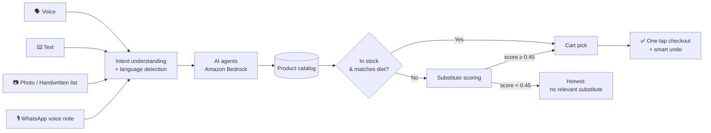

<div align="center">

# ⚡ Pulse Now

### From need to done — in seconds.

**An India-first, AI-powered, ambient quick-commerce experience inside Amazon Now.**
Built for **Amazon HackOn 6.0** · *Reimagining Urgent Shopping*

[](https://pulsenowamazon.vercel.app/)


</div>

---

## 📖 What is Pulse Now?

When something is urgent, nobody wants to browse 40 product pages. **Pulse Now** lets a customer simply *express a need* and builds the cart for them.

A customer can **type it, speak it, snap it, scribble it, or send it as a WhatsApp-style voice note**. Pulse understands the request, matches it against the real catalog, and hands back a ready-to-confirm cart.

### Two principles behind every recommendation

| Principle | What it means |
|---|---|
| 🎯 **Catalog-grounded** | Every suggestion is a real SKU from the catalog. No hallucinated products and no out-of-stock surprises. |
| 🧑‍🤝‍🧑 **Personalised, privately** | An onboarding profile (diet, preferences) is saved **on the device** and shapes every result. |

---

## ✨ How it works



---

## 🆕 What's new in v1.4

### 📱 Upload, rebuilt and bug-free
The mobile upload bug is fixed. `/upload` now has **two separate flows** that no longer interfere with each other:

| Flow | Behaviour |
|---|---|
| 📸 **Camera Scan** | Opens the live device camera via `getUserMedia` with `facingMode: environment`. Falls back to a file input with `capture="environment"` on browsers without a media-stream API. |
| 🖼️ **Upload from Device** | A pure file picker with **no** `capture` attribute, so phones open the **gallery**, not the camera. |

Every image is **validated** (type and size) and **downscaled** (≤ 1600 px, JPEG quality 0.85) before it reaches Bedrock. The old silent "Vision failed" path now shows a clear message.

### 🎙️ Voice-note upload (WhatsApp style)
A new tab on `/upload`, also reachable from the floating Pulse AI assistant.

- **Accepts:** `mp3` `wav` `webm` `ogg` `mp4` `aac` `m4a`, max **12 MB**
- **Preview:** audio player with file name, size and format
- **Editable transcript:** the demo doesn't depend on a paid Transcribe subscription. In production, audio is posted to **Amazon Transcribe** and the transcript is forwarded to the model.
- **Output:** detected language, extracted items, matched catalog picks, out-of-stock and not-in-catalog blocks, and one tap to checkout
- **Samples:** `data/voiceNoteSamples.json` (Hinglish, Hindi, English)

### 🤖 AI is always active, with no silent mock
| Setting | Behaviour |
|---|---|
| `USE_MOCK_AI=false` *(default)* | AI failures show **real, human-readable errors** instead of a fake response. |
| `USE_MOCK_AI=true` | Falls back to deterministic matching when Bedrock fails (for offline demos). |

`aiAvailability()` exposes `bedrock_enabled`, the model id, `mock_allowed` and a `config_error` string, consumed by the `<AIStatusPill>` and the AI-status banner.

### 🗣️ Language consistency
A new `detectLanguage()` recognises **English**, **Hindi** and **Hinglish**. Every AI prompt carries
`DETECTED INPUT LANGUAGE: <lang>. You MUST respond in <lang>.`

> **Verified:** `"Mujhe vegan snacks chahiye jaldi"` → `"Yahan par kuch vegan snacks hain..."`

### 🔁 Smarter handling of unavailable products
When an item is out of stock, Pulse scores every candidate substitute in `lib/agents/smartCartAgent.ts`:

```
substituteScore =
    0.30 × sameCategoryScore
  + 0.25 × preferenceMatchScore
  + 0.20 × availabilityScore
  + 0.10 × etaScore
  + 0.10 × ratingTrustScore
  + 0.05 × priceSimilarityScore
```

| Rule | Why |
|---|---|
| **Threshold 0.45** | Below it, nothing is shown. Pulse says *"no relevant substitute available"* rather than pushing a bad one. |
| **Dietary hard-block** | Vegan, Jain and vegetarian violations are rejected **before** scoring. |

### 🗓️ Scheduled orders
`lib/scheduledOrders.tsx` (localStorage provider) powers the `/scheduled-orders` page, with a full lifecycle: **create · edit · pause · resume · skip-next · delete**.

- **Frequencies:** daily, alternate days, weekly, custom days, every *N* days, monthly
- **Trust controls:** confirm-before-each-run, plus a substitute policy (`auto` / `ask` / `never`)
- **Production path (stubbed):** `/api/schedules` and `/api/schedules/[id]` document the target architecture of **EventBridge Scheduler → Lambda → DynamoDB → Amazon Pay**

### 🚪 Onboarding skip, fixed
"Skip onboarding" (top bar) and "Skip for now" (welcome step) both go straight to `/` and set `onboardingComplete=true` and `personalizationEnabled=false`. The redirect guard no longer drags users back. Preferences stay editable under **Profile → Preferences → Edit preferences**.

### ⏱️ Smarter undo
The undo window scales with how much money is at stake:

| Order total | Window | Controls |
|---|---|---|
| **≤ ₹500** | 5 seconds | Countdown ring only |
| **> ₹500** | 10 seconds | Countdown ring + green **Confirm now** button (top-right of the toast) |

### 🏠 A bigger, more professional homepage
Fourteen sections modelled on real quick-commerce homepages, without copying anyone's UI:

| # | Section | # | Section |
|---|---|---|---|
| 1 | Hero: logo, tagline, AI status pill | 8 | Emergency kits (8 cards) |
| 2 | Welcome / undo banner | 9 | Guided journeys (8 cards) |
| 3 | Delivery + dark-store strip | 10 | Pulse Upload (list / packet / photo / voice note) |
| 4 | Search + voice + chips | 11 | Scheduled orders panel |
| 5 | Quick actions (voice, list, voice note, camera, packet, emergency, schedule) | 12 | Smart combos |
| 6 | Shop by category (16 categories with badges) | 13 | Why Pulse Now stats |
| 7 | Personalised for you · Predicted reorder | 14 | Privacy & trust + footer |

### 🌗 Theme toggle
Under **Feature Panel → Settings → Appearance**. Light by default (matches Amazon). All colours are CSS variables on `<html data-theme>`, and a `<head>` boot script prevents any flash.

---

## 🚀 Quick start

```bash
# 1. Install
npm install

# 2. Configure environment (see table below)
cp .env.example .env.local     # or create .env.local manually

# 3. Run
npm run dev
# → open http://localhost:3000
```

### Environment variables

| Variable | Purpose | Default |
|---|---|---|
| `BEDROCK_MODEL_ID` | Which Bedrock model the agents call | `amazon.nova-lite-v1:0` |
| `USE_MOCK_AI` | Allow deterministic fallback when Bedrock fails | `false` |
| AWS credentials | Standard AWS SDK credentials and region with Bedrock access | n/a |

> 🔐 **Security:** never commit `.env.local` or AWS keys. If keys were ever shared or committed, rotate them (**IAM → Users → Security credentials**).

---

## 🧠 Choosing the AI model

The codebase uses whatever model id is set in `BEDROCK_MODEL_ID`, so **switching models is a one-line change**.

### Default: Amazon Nova Lite
Cheap, Amazon-native, and good enough at vision and JSON output for the demo.

### Switching to Claude on Bedrock
Anthropic models on Bedrock are billed through **AWS Marketplace**, so the account needs a valid payment method. Without one, calls fail with:

```
INVALID_PAYMENT_INSTRUMENT — A valid payment instrument must be provided.
Your AWS Marketplace subscription for this model cannot be completed at this time.
```

To enable Claude:

1. **AWS Console → Billing and Cost Management → Payment methods** and add a card
2. Wait about 2 minutes
3. **Bedrock console → Model access** and confirm the Claude model shows *Access granted*
4. Set in `.env.local`:
   ```bash
   BEDROCK_MODEL_ID=us.anthropic.claude-sonnet-4-5-20250929-v1:0
   ```
5. Restart `npm run dev`

> Use the exact model id your Bedrock console lists for your region. Newer Claude models can be dropped in the same way.

---

## 🗺️ Routes

### Pages

| Route | Purpose |
|---|---|
| `/onboarding` | Spotify-style profile capture. Skip goes straight home. |
| `/` | Big quick-commerce homepage (14 sections) |
| `/chat` | Conversational Pulse AI |
| `/intent` | SmartCards + parallel AI cart |
| `/guided` | AI-driven Q&A that builds a kit |
| `/emergency` | Tiered emergency situations |
| `/emergency/custom` | Free-form Bedrock kit builder |
| `/upload` | Photo / handwritten list / voice note *(renamed from `/scan`)* |
| `/scan` | Legacy redirect to `/upload` |
| `/scheduled-orders` | Auto-reorder schedule manager |
| `/checkout` | Editable cart, OneConfirm |
| `/order-success` | Tracking + dynamic undo |
| `/dashboard` | Architecture + ranking math |
| `/pitch` | Story-mode deck |

### API

<details>
<summary><b>Click to expand all API routes</b></summary>

`/api/chat` · `/api/smart-cart` · `/api/recommend` · `/api/guided` · `/api/emergency-tiers` · `/api/predict-reorder` · `/api/scan-list` · `/api/scan-product` · `/api/explain` · `/api/checkout` · `/api/understand-intent` · `/api/upload/voice-note` · `/api/vision/scan-list` · `/api/vision/scan-product` · `/api/schedules` · `/api/schedules/[id]`

</details>

---

## ✅ Testing checklist

| Feature | How to test | Pass criteria |
|---|---|---|
| **Mobile upload bug** | On phone, open `/upload`, tap *Upload from Device* | Gallery opens, **not** the camera. A JPG/PNG returns AI matches. |
| **Camera scan** | On phone or webcam laptop, tap *Camera Scan* | Permission prompt → live video → Snap → AI matches |
| **Vision failure** | Upload a 7 MB image | Toast: "Image is X MB. Max allowed is 6 MB." (no silent mock) |
| **Voice note** | `/upload?mode=voice` → pick a sample → Submit | Picks render in the detected language, not-in-catalog items shown separately |
| **Skip onboarding** | Fresh browser → `/onboarding` → *Skip onboarding* | Lands on `/`. Banner: "Onboarding skipped — you can personalise from Settings." |
| **Mock-mode toggle** | Set `USE_MOCK_AI=true`, restart, force a Bedrock failure | Falls back to deterministic match. With `false`, fails loudly. |
| **AI active mode** | Call `/api/chat` | Returns `bedrock_enabled: true`, `mock_allowed: false` (also visible in the AI status pill) |
| **Language match** | Type `Mujhe vegan snacks chahiye` in `/chat` | Reply is in Hinglish |
| **Substitute logic** | Type `diapers, baby formula, organic baby food, stroller` | 4 catalog picks + 4 not-in-catalog items, no irrelevant substitutes |
| **Schedule milk** | `/scheduled-orders` → New → Amul milk × 2, alternate days, 17:00 | Card saved. "Next:" shows tomorrow 5 PM (or +2 days). |
| **Undo ≤ ₹500** | Place an order under ₹500 | 5-second timer ring, no *Confirm now* button |
| **Undo > ₹500** | Place an order over ₹500 | 10-second timer ring + green *Confirm now* button |
| **Theme toggle** | Profile → Settings → Appearance | Light/Dark flips instantly |

---

## 🗂️ What changed in v1.4 (file map)

<details>
<summary><b>🆕 New files</b></summary>

```
app/upload/page.tsx                  Renamed from /scan; Upload-from-device + Camera + Voice tabs
app/scan/page.tsx                    Redirects to /upload
app/scheduled-orders/page.tsx        Schedule manager
app/api/upload/voice-note/route.ts   Voice-note → cart pipeline
app/api/schedules/route.ts           Production-shape contract
app/api/schedules/[id]/route.ts
components/UnavailableSection.tsx    Also used in voice-note results
lib/agents/language.ts               Hinglish / Hindi / English detector
lib/scheduledOrders.tsx              Provider + computeNextRunAt
data/voiceNoteSamples.json
data/categoryVisuals.json
data/scheduledOrders.json
```
</details>

<details>
<summary><b>✏️ Modified files</b></summary>

```
app/page.tsx                  14-section homepage
app/onboarding/page.tsx       Skip-all path that goes home
app/order-success/page.tsx    Wires UndoToast with order total
app/api/chat/route.ts         Forwards preferences
app/layout.tsx                Adds ScheduledOrdersProvider
components/AppShell.tsx       Renames Scan → Upload in nav
components/UndoToast.tsx      Dynamic timing + Confirm now
lib/aws/bedrockClient.ts      USE_MOCK_AI flag, no silent fallback, humanised errors
lib/agents/smartCartAgent.ts  Language detection + substituteScore
lib/agents/chatAgent.ts       Same-language output rule
lib/agents/visionAgent.ts     Real errors surface; voice-note pipeline
lib/agents/index.ts           Re-exports
.env.local                    USE_MOCK_AI flag, sane defaults
```
</details>

---

## 📜 License

MIT, built with ❤️ for **Amazon HackOn 6.0**.

<div align="center">

**[🚀 Try the live demo →](https://pulsenowamazon.vercel.app/)**

</div>
